# Consumer (ΚΧ) — user manual

*Section of the MDMS-Cy user manual. Spec: project.pdf §1.1–§1.4, pp. 5–7.*

The consumer area is for the owner of one or more premises. After logging in with your email and password, the menu at the top shows the eight consumer pages. Every page checks your role; an officer, technician, operator or supplier who opens a consumer page gets **"Access denied — Your role does not allow this page"** (HTTP 403).

All times on these pages are **UTC**, as they are stored. Demo accounts (data of `import.sql`): `consumer1@example.cy` … `consumer9@example.cy`, password `Passw0rd!23`. `consumer2@example.cy` owns a prosumer premise (#3) and an ordinary one (#4).

**Messages you may see on any page.** Every refusal shows the database's own reason in a red box. The data is never silently hidden.

| Message starts with | Meaning |
|---|---|
| Permission denied | The premise, meter, bill or request is not yours. |
| Invalid input | A field is missing or wrong (the message says which). |
| Access to past data is not bought / outside the retention time | See §5 below. |
| Duplicate | You already have an open request of that kind. |
| The form is no longer valid | The page was open too long or in another session. Reload it and try again. |
| The operation could not be completed … reference *xxxx* | Unexpected server problem. Quote the reference to the administrator. |

---

## 1. My premises

**Purpose.** See your premises and register a new one (§1.1 p.5: a consumer may have several premises, each with a Premise ID, address, WGS84 coordinates, usage and administrative area).
**Who.** Consumers.

**Steps.**

1. Open **My premises**. The table lists, for each premise:
   - the Premise ID;
   - the address and its area (parish, municipality, district, postal code);
   - the WGS84 latitude and longitude;
   - the usage (residential, commercial, industrial, agricultural) and prosumer scheme;
   - the supplier;
   - the meter in service and its status;
   - the monthly threshold.

   The links on each row open that premise's readings, totals and events.
2. To add a premise, fill in **Add a premise**: address, latitude and longitude (decimal degrees, e.g. 35.185600 and 33.382300), usage, district, municipality, parish, 4-digit postal code, prosumer scheme (none, Net Metering or Net Billing) and optionally the supplier.
3. Press **Add premise**. The new Premise ID is shown at the top. The meter is installed later by a technician, after an officer creates the installation job.

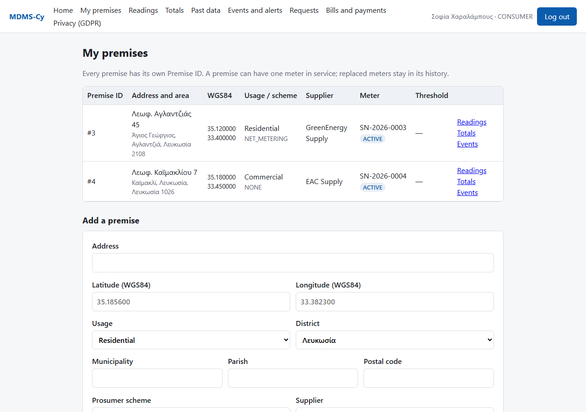

**Errors.** "Invalid input: the postal code needs 4 digits", "…the district must be one of the 6 districts", "…the coordinates are not valid".

## 2. 15-minute readings

**Purpose.** Follow the 15-minute consumption of a premise. For a prosumer, the energy imported from the grid (OBIS 1.8.0) and the energy exported from PV (2.8.0) are shown side by side, with the net value (§1.2 p.5).
**Who.** The owner of the premise.

**Steps.**

1. Open **Readings**.
2. Choose the premise and the dates (*To* is included). At most 31 days are shown at a time.
3. Press **Show**. The line above the table gives the number of slots and the total import, export and net.

The *Status* column shows how each value was produced by validation (VEE):

- **VALID** — the reading passed the checks;
- **ESTIMATED** — a missing slot was filled by estimation;
- **EDITED** — corrected by the operator;
- **PENDING** — not validated yet.

The first slot of a period may be empty, because the energy of a slot is the difference from the previous reading.

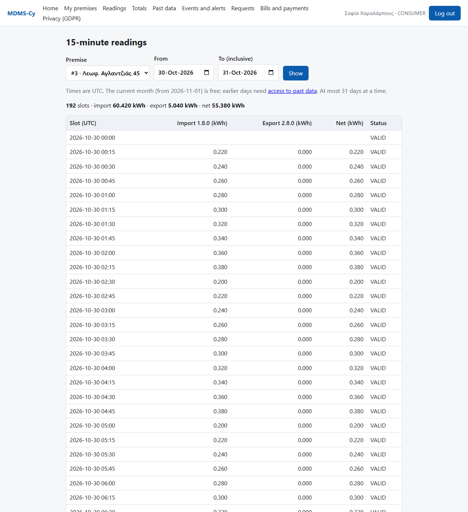

**Errors.** "…the window must have from < to and at most 31 days"; for past months, see §5 and the next figure.

## 3. Totals by day, month and year

**Purpose.** Daily, monthly or yearly totals per OBIS code, read from the stored aggregates rather than recomputed from the raw readings (§1.2 p.6). Only final totals (after VEE) are shown. The access rules are the same as for the readings.
**Who.** The owner of the premise.

**Steps.**

1. Open **Totals**.
2. Choose the premise, the period (daily, monthly, yearly) and the dates.
3. Press **Show**.

The default windows are:

- **daily:** this month;
- **monthly:** this year;
- **yearly:** the last five years.

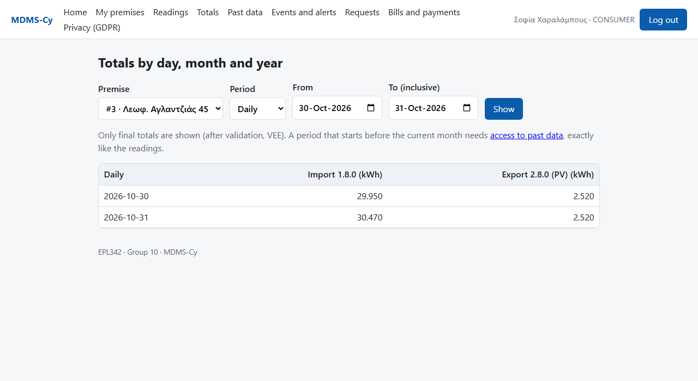

## 4. Events and alerts

**Purpose.**

- Voltage events of your meters: undervoltage (sag) and overvoltage (swell).
- Your monthly consumption threshold.
- How you want to be notified: email and/or SMS (§1.2 pp. 5–6).

**Who.** The owner of the premise.

**Steps.**

1. Open **Events and alerts** and choose the premise.
2. **Monthly consumption threshold.** Enter a number of kWh per month and press **Save threshold**; **Remove** clears it.
3. **How to notify me.** Tick *Email* and/or *SMS* and press **Save preferences**. The SMS goes to the phone number of your profile.
4. The **Events** table lists the voltage and threshold events of the premise, newest first.
5. The **Notifications** table lists, for every threshold alert, one line per channel: when, channel, address, status and message.

When the month-to-date import of the premise passes the threshold, the system raises a *Threshold exceeded* event, at most once per month. It then records one notification per chosen channel.

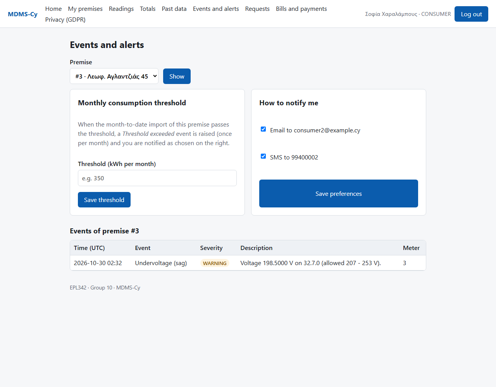

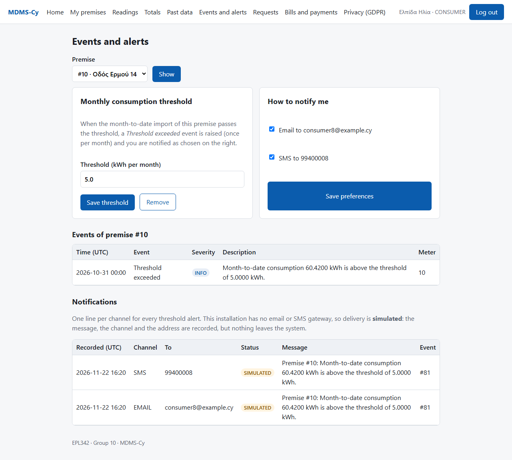

> **Limitation.** This installation has no email or SMS gateway. Notifications are recorded with status **SIMULATED**: the message, channel and address are stored and shown, but nothing is sent. They are never shown as "sent". **FAILED** means SMS was chosen but the profile has no phone number.

## 5. Past data

**Purpose.**

- The readings and totals of the **current month are free**. Earlier months are a paid service, per meter and per month (§1.2 p.6).
- What can be bought is limited by how long the data is kept: raw readings are kept **3 years**, or **1 month** after an approved retention request (§1.4 pp. 6–7).

**Who.** The owner of the premise.

**Steps.**

1. Open **Past data**.
2. Choose the premise and the months, then press **Get the price**. The page shows the number of months, the fee per month, the total, and the oldest date still kept for the meter.
3. If the period can be bought, choose how to pay and press **Buy access for … €**. You are taken to the readings of that period.
4. **Access bought** lists your previous purchases.

When you ask for an earlier month that you have not bought, the Readings and Totals pages say why the data is hidden and link to this page. They never show an empty table.

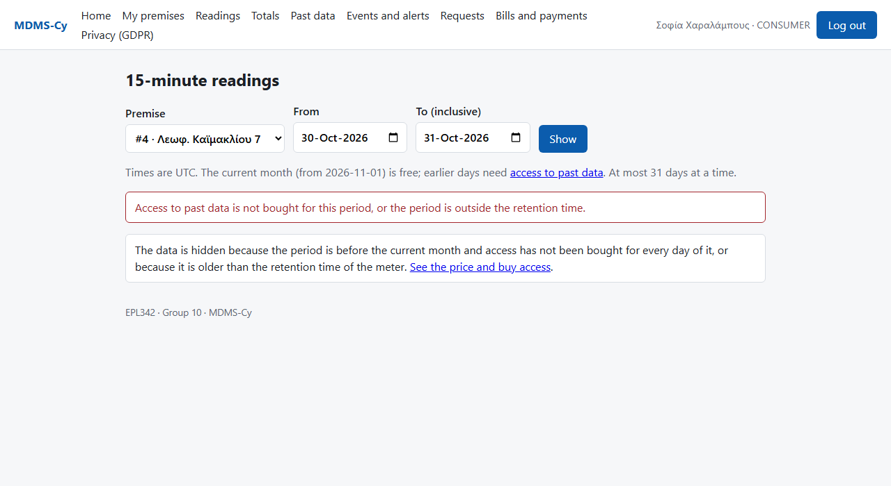

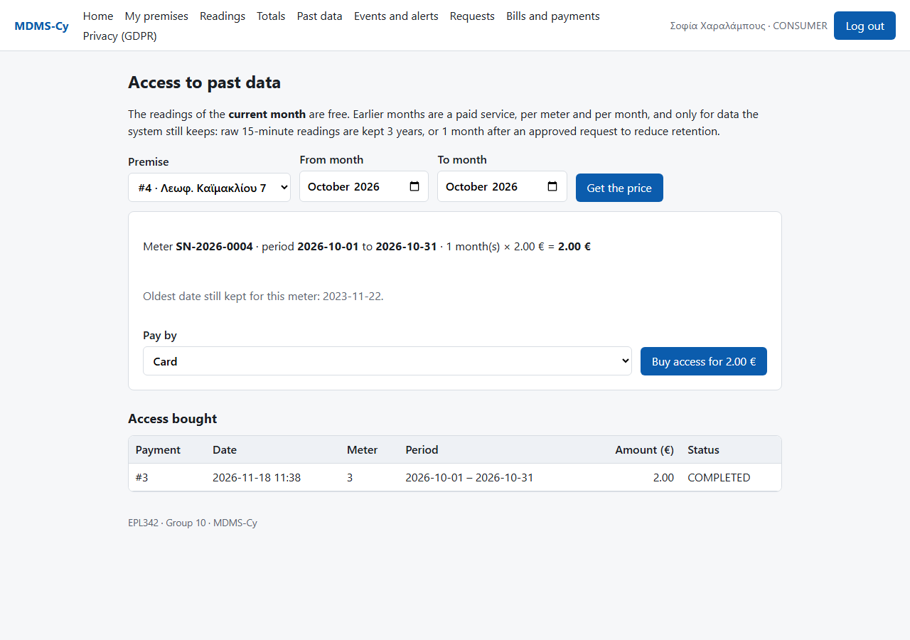

**Errors.**

- "This period cannot be bought": it must end before the current month and start after the oldest date kept.
- "The current month is free; only earlier months can be bought."
- "The period is outside the retention time of this meter."

## 6. Check and fault requests

**Purpose.** Ask for a meter check or report a fault for a premise, then follow the request until it is completed (§1.3 p.6).
**Who.** The owner of the premise.

**Steps.**

1. Open **Requests**.
2. Choose the premise and the type:
   - **Fault report**;
   - **Meter check** — the MDMS-Cy fee applies (see §7).
3. Describe the problem and press **Submit request**. The request is created as **SUBMITTED** and its page opens.
4. **My requests** lists all your requests with:
   - the status: SUBMITTED → ASSIGNED → ACCEPTED → IN_PROGRESS → COMPLETED, or CANCELLED;
   - the visit time and the technician.
5. **History** shows every change: when, from which state to which, who did it, and the comment.
6. While the request is still SUBMITTED you can **Cancel the request**, with an optional reason.

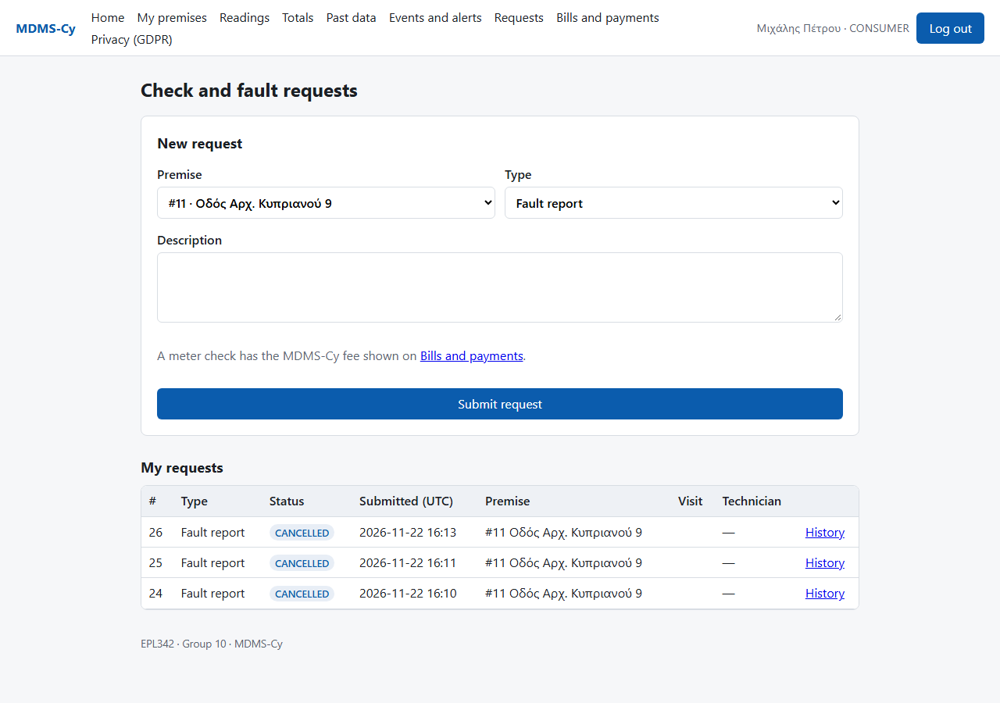

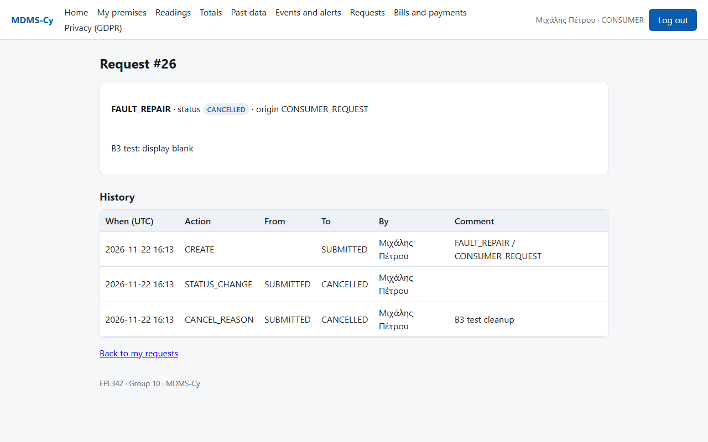

**Errors.** "The work order cannot be cancelled in its current state" (it is already assigned); "Permission denied: not your work order".

## 7. Bills and payments

**Purpose.**

- Your bills with what is paid and what is left.
- Paying a bill, in full or in part.
- Paying an MDMS-Cy service fee (e.g. meter check).
- The full payment history (§1.3 p.6).

Every payment keeps its link to the consumer, the supplier, the bill or the service.
**Who.** Consumers.

**Steps.**

1. Open **Bills and payments**.
2. **Bills** shows each bill: period, premise, supplier, tariff, amount, paid, left, status and due date.
3. To pay an open bill, change the amount if you want to pay part of it, choose the method and press **Pay**.
4. **Pay an MDMS-Cy service fee.** Choose the service and the method and press **Pay fee**. The amount is always the fee of the service, never typed in. Access to past data is bought on its own page (§5).
5. **Payment history** lists every payment and what it was for.

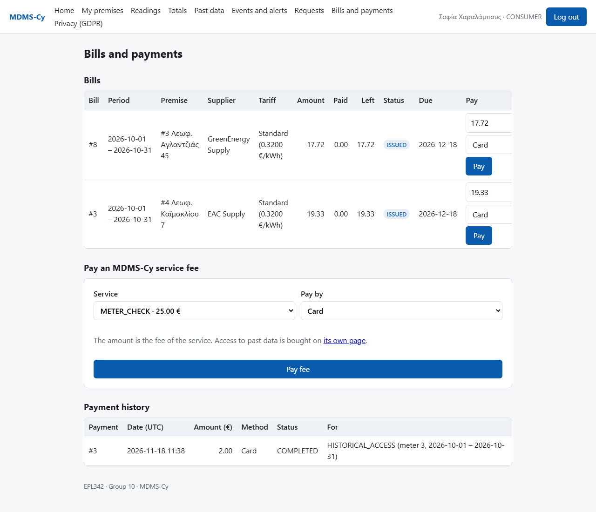

**Errors.**

- "…the amount is more than what is left to pay".
- "The bill is already paid or cancelled".
- "Permission denied: not your bill".

Two payments of the same bill at the same moment cannot overpay it: the database locks the bill row while it is being paid.

## 8. Privacy (GDPR)

**Purpose.** Exercise your rights under §1.4 pp. 6–7:

- **Keep the raw readings of one meter for 1 month only** (retention reduction), or
- the **right to be forgotten**.

A request is never carried out at once. An officer reviews it and pre-approves it, a second officer gives the final approval, and only then is it executed. Every stage is logged with its date and user.
**Who.** Consumers.

**Steps.**

1. Open **Privacy (GDPR)**.
2. Choose the request. For the retention request, choose the meter. For the right to be forgotten, tick the confirmation box.
3. Press **Submit request**.
4. **My requests** shows each request with its status (SUBMITTED → UNDER_REVIEW → PRE_APPROVED → APPROVED → EXECUTED, or REJECTED) and the history of its stages.

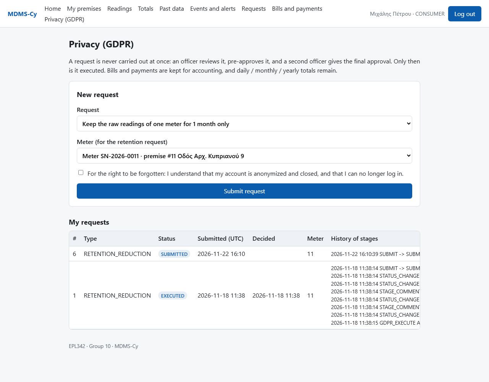

What execution does:

- The **right to be forgotten** anonymizes and closes the account, so you can no longer log in.
- Raw readings are cut to one month, and email/phone are removed from stored notifications.
- Bills and payments are kept for accounting, and daily/monthly/yearly totals remain.

**Errors.** "Duplicate: you already have an open request of this type"; "Please tick the box…".

---

**Wrong role.** Any non-consumer who opens a consumer page sees:

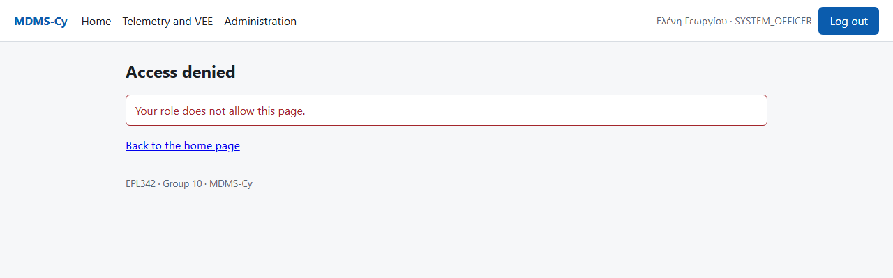
