# DSO, TSO and map — user manual

*Section of the MDMS-Cy user manual. Spec: project.pdf §2.4, §3.1–§3.2, §4.1–§4.2, pp. 8–10.*

The **DSO** (distribution operator) receives the telemetry, validates it and watches the low-voltage network. The **TSO** (transmission operator) watches the whole grid and can shed load. After logging in, the menu shows only the pages of your role; any other page answers "Access denied" (403).

All times are **UTC**, in slots of 15 minutes. Demo accounts (data of `import.sql`): `dso@mdms.cy`, `tso@mdms.cy`, `officer1@mdms.cy`, password `Passw0rd!23`.

| Page | DSO | TSO | Officer | Admin |
|---|---|---|---|---|
| Ingest, VEE, suspect readings, finalize | yes | – | yes | – |
| Network reports | yes | – | – | – |
| Events | yes, and reports tampering | yes | yes | – |
| Grid overview, remote shedding, edit a transformer | – | yes | – | – |
| Current state | yes | yes | – | – |
| Frequency | yes, and records | yes | – | – |
| Transformer tree, map | yes | yes | yes | yes |

**Messages.** A refusal shows the database's own reason in a red box. "Invalid input" = a field is wrong. "Not found" = no such reading, meter or transformer. "Busy" = the same job is already running; try again. "The form is no longer valid" = reload the page.

---

# Part A — DSO

The pages follow the daily order: **ingest → VEE → decide the suspects → finalize**. The start page shows the number of suspect readings and the latest critical events.

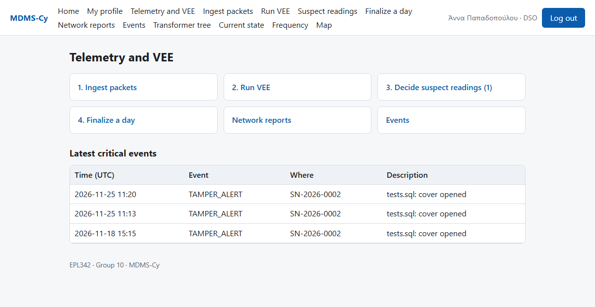{width=4.6in}

## 1. Ingest packets

**Purpose.** Enter a telemetry packet, or a batch, by hand (§3.1 p. 8). **Procedures.** `sp_IngestTelemetryPacket`, `sp_IngestTelemetryBatch`.

1. Choose **One packet** (at most 4,000 characters) or **Batch** (a JSON array, at most 2 MB).
2. Paste the JSON. An example is at the bottom of the page.
3. Press **Ingest**. The answer shows the packet number, its result and how many readings were stored.

| Result | Meaning |
|---|---|
| MATCHED | the meter exists and is active; its readings wait for VEE |
| UNMATCHED | unknown network id |
| QUARANTINED | the meter exists but is not active |
| COMM_ERROR | not a valid packet |

No packet is lost: all four kinds are stored. A reading that already exists for the slot is skipped and recorded as an event.

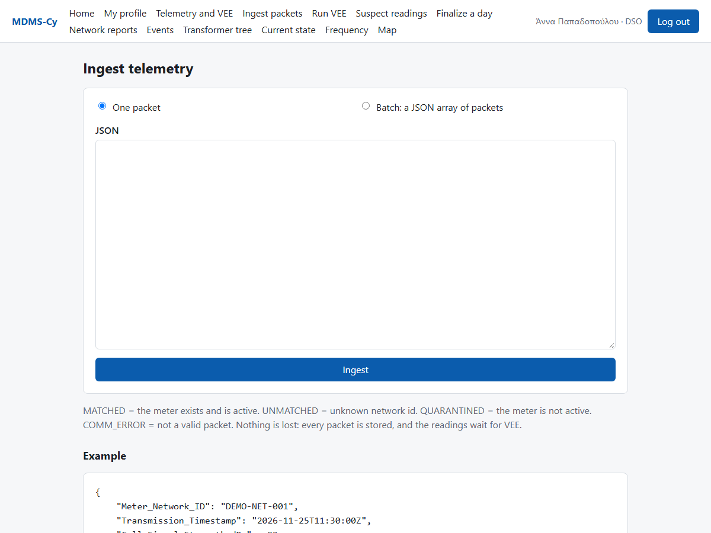{width=4.6in}

## 2. Run VEE

**Purpose.** Validate the new readings and fill gaps (§3.2 pp. 8–9). **Procedure.** `sp_RunVEE`.

1. Give the first and the last slot (both included), and optionally one meter number.
2. Press **Run VEE**. The result counts the meters and the valid, suspect and estimated readings.

VEE checks the range of the code, a register that goes down, spikes, and more energy than the meter type can carry. What passes becomes **VALID**; the rest waits as **SUSPECT**. Gaps are filled by interpolation (**ESTIMATED**).

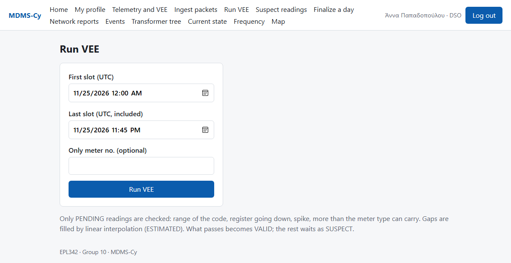{width=4.6in}

## 3. Suspect readings

**Purpose.** Decide what VEE could not. **Procedures.** `sp_ListSuspectReadings`, `sp_AcceptSuspectReading`, `sp_EditReading`.

Each row shows the value, its neighbours before and after, and the rule that stopped it. The screenshot is the example of the specification: 25.4 kWh against a recent average of 1.9.

- **Accept as is** – the value is right.
- **Edit** – type the correct value and, if you like, a note. The original value is kept.

The form below the list changes an estimated or an already edited reading by its number. A final reading cannot be changed.

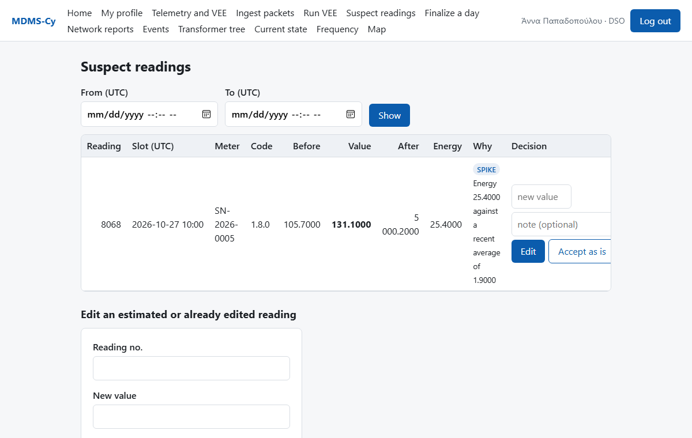{width=4.6in}

## 4. Finalize a day

**Purpose.** Make a finished day final and build its sums (§3.2 p. 9, §4.2 p. 10). **Procedures.** `sp_FinalizeReadings`, `sp_BuildTransformerAggregates`.

1. **Readings of the meters.** Choose a day that has ended and press **Finalize**. A meter is skipped, with the reason, if it has fewer than 96 slots of 1.8.0 or a pending or suspect reading.
2. **Aggregates of the transformers.** Press **Build aggregates** after the meters. If some active meters are not final, the box must be ticked; their energy is then missing for ever.

**Neither step can be undone.**

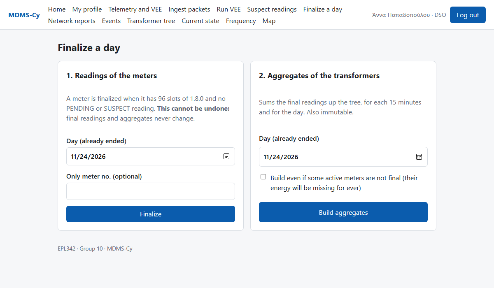{width=4.6in}

## 5. Network reports

**Purpose.** Analyse the quality of the network. **Procedures.** `sp_ReportVoltageEvents`, `sp_ReportPhaseUnbalance`, `sp_ReportTechnicalLosses`.

Choose the report, the transformer and the window (the end is not included), then press **Show**.

| Report | Shows | Notes |
|---|---|---|
| Voltage sags and swells | per meter: readings outside 207–253 V, lowest and highest, events | covers everything under the transformer |
| Phase unbalance | slots above the limit, worst first | at most 500 are shown |
| Technical losses | measured input, delivered energy, loss in kWh and % | level-1 transformer with its own measurements; above 8 % is marked as possible theft |

**Record events for this report** (unbalance and losses) stores the findings as events. Only viewing never does.

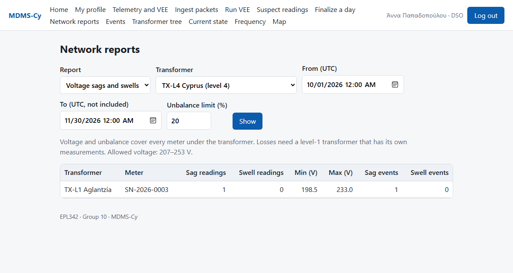{width=4.6in}

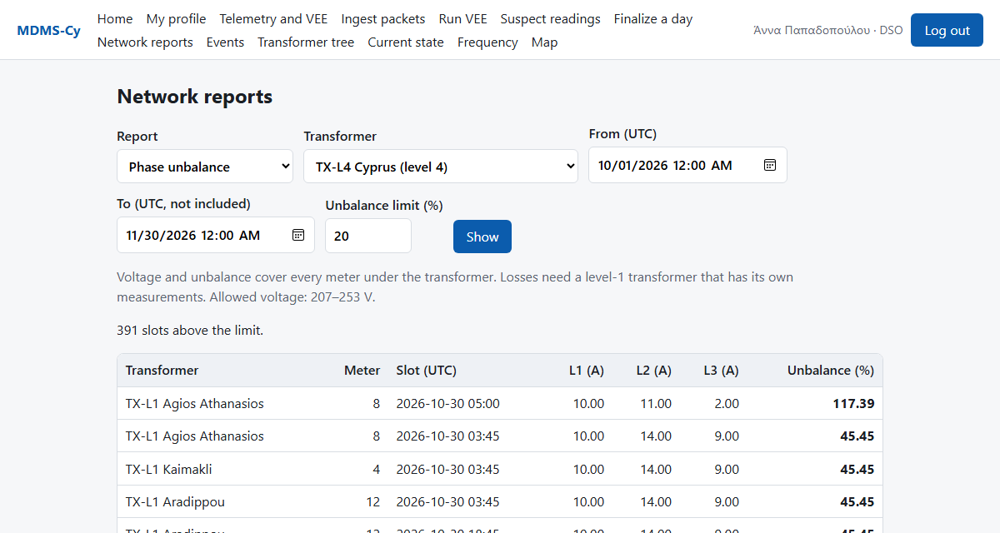{width=4.6in}

## 6. Events

**Purpose.** See what the system noticed, and report tampering (§2.4 p. 8). **Procedures.** `sp_GetEvents`, `sp_RaiseTamperEvent`.

Filter by type, severity and dates. To report tampering (DSO only), give the network id of the meter: the alert is recorded and an anti-tamper job for a technician is created.

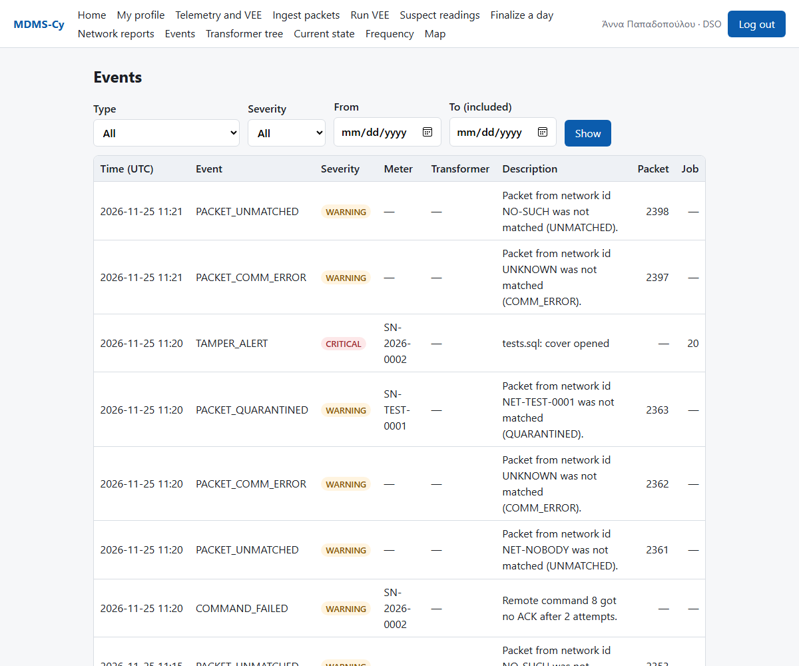{width=4.6in}

---

# Part B — TSO

## 7. Grid overview

**Purpose.** The state of the grid in one screen (§4.2 p. 10). **Procedures.** `sp_GetGridOverview`, `sp_RefreshTransformerState`.

The boxes show the slot, the import and export of the grid, the overloaded transformers and the critical events of the last 24 hours. The table has a row per transformer. Load is the energy of the slot × 4 (average kW) over the capacity.

- **Show** displays a slot. Empty = the latest.
- **Refresh the state** computes every transformer again. Empty = the latest slot with verified readings. Meters without a reading are left out.

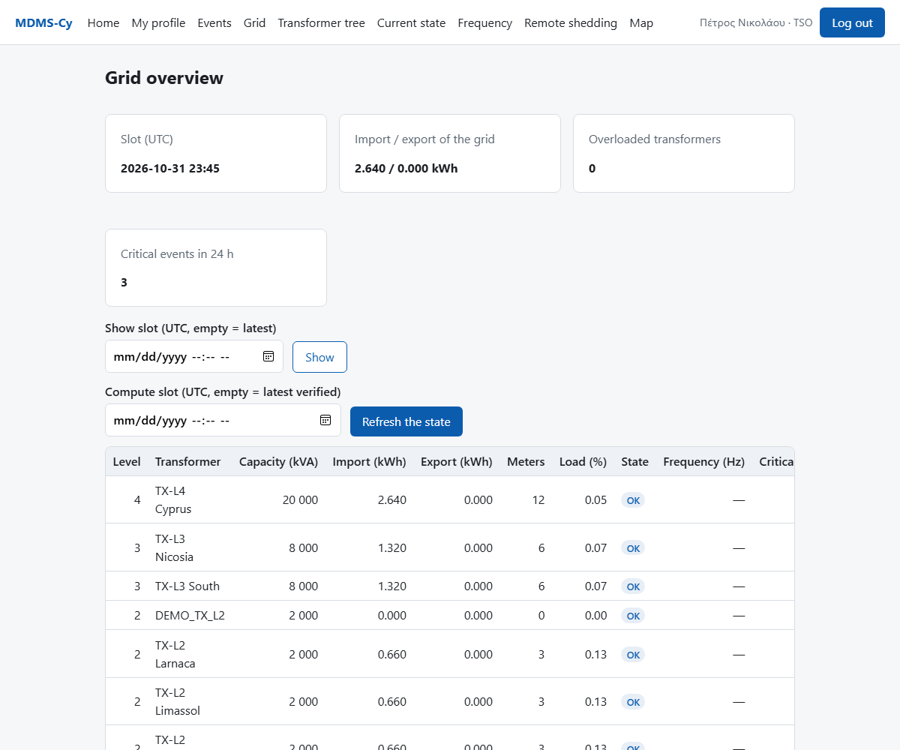{width=4.6in}

## 8. Transformer tree

**Purpose.** The hierarchy of the geofences (§4.1 p. 9). **Procedures.** `sp_GetTransformerTree`, `sp_RefreshTransformerAncestors`, `sp_UpsertTransformer`.

Each line shows the level, capacity, meters and energy. **Subtree** shows one branch. **Refresh one transformer and its ancestors** (TSO, DSO) reads one level-1 transformer again and updates every level above it.

**Add a transformer** and **Edit** (TSO) take the name, level (1 = low voltage), capacity, position, parent, and the geofence rectangle (all four sides or none).

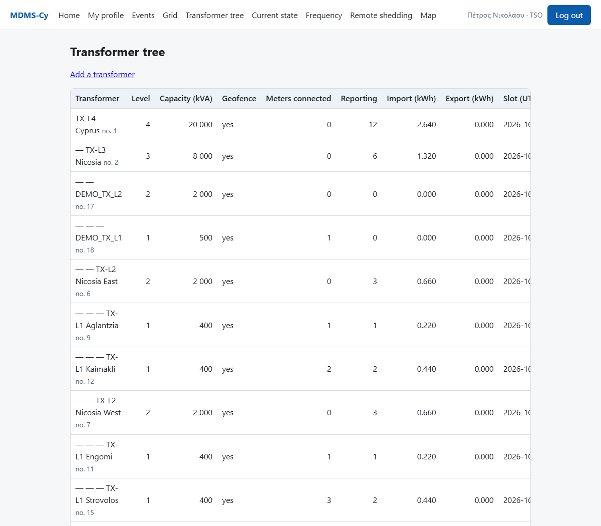{width=4.6in}

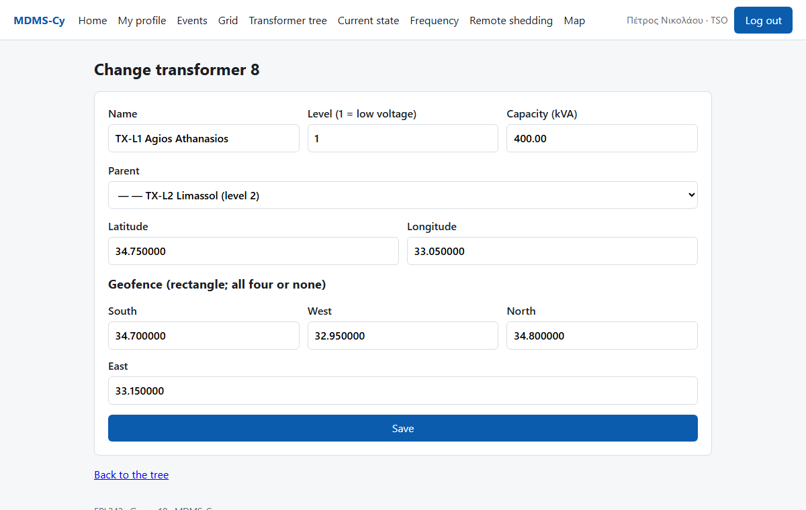{width=4.6in}

## 9. Current state

**Purpose.** The stored state, filtered by branch and level. **Procedure.** `sp_GetTransformerState`. It changes only when it is refreshed (section 7 or 8); **Computed** shows when.

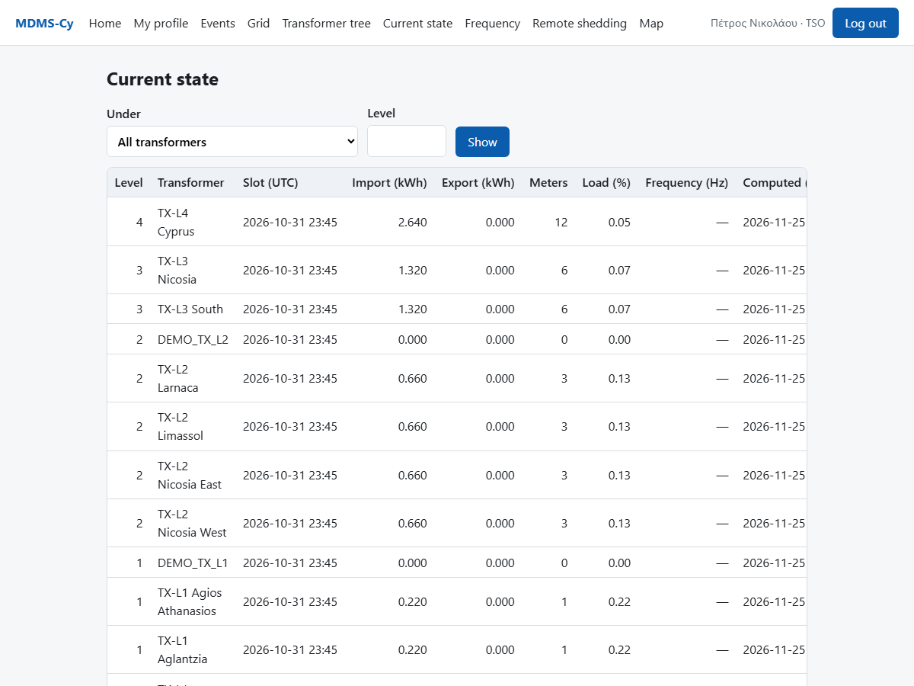{width=4.6in}

## 10. Frequency

**Purpose.** Follow the grid frequency (§II.Δ p. 3). **Procedure.** `sp_RecordTransformerReading`.

The page lists the latest frequency of each transformer and the latest deviations. A value more than 0.2 Hz from 50 Hz raises a critical event. Only the **DSO** records measurements: choose the transformer, the code (14.7.0 frequency, or 1.8.0 / 2.8.0 energy for the loss report), the slot and the value.

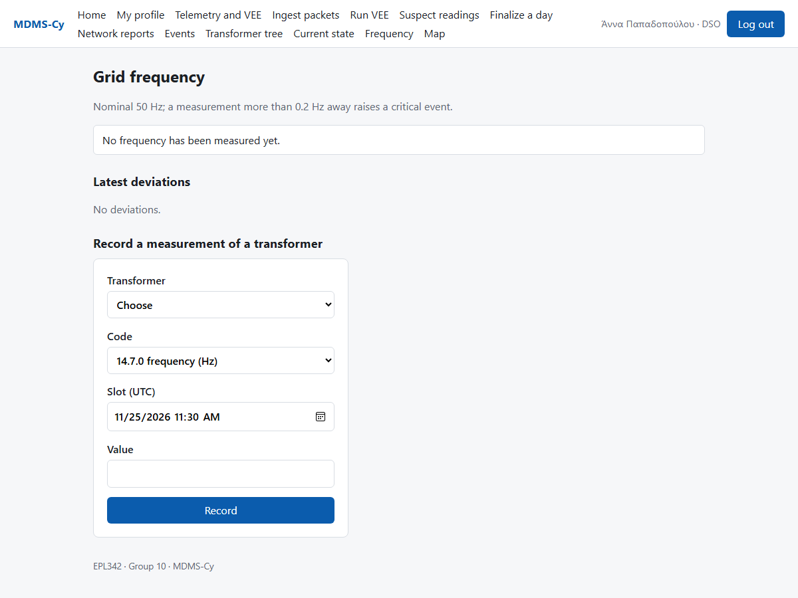{width=4.6in}

## 11. Remote shedding

**Purpose.** Disconnect or reconnect all the active meters under a transformer (§II.Δ p. 3, §2.4 p. 8). **Procedures.** `sp_ShedTransformerLoad`, `sp_DispatchCommands`, `sp_ListCommands`.

1. **Choose** the transformer, the command and a reason, and press **Check what is affected**. Nothing happens yet.
2. **Confirm.** Read how many meters are connected there, tick the box and press **Create the commands**. Either all the commands are created or none.
3. **Dispatch** one command, or every waiting one. The last includes the approved commands of officers and of the DSO.

Each dispatch is one attempt. If there is still no answer after 3 attempts, the next dispatch marks the command FAILED and raises an event. Every attempt is logged.

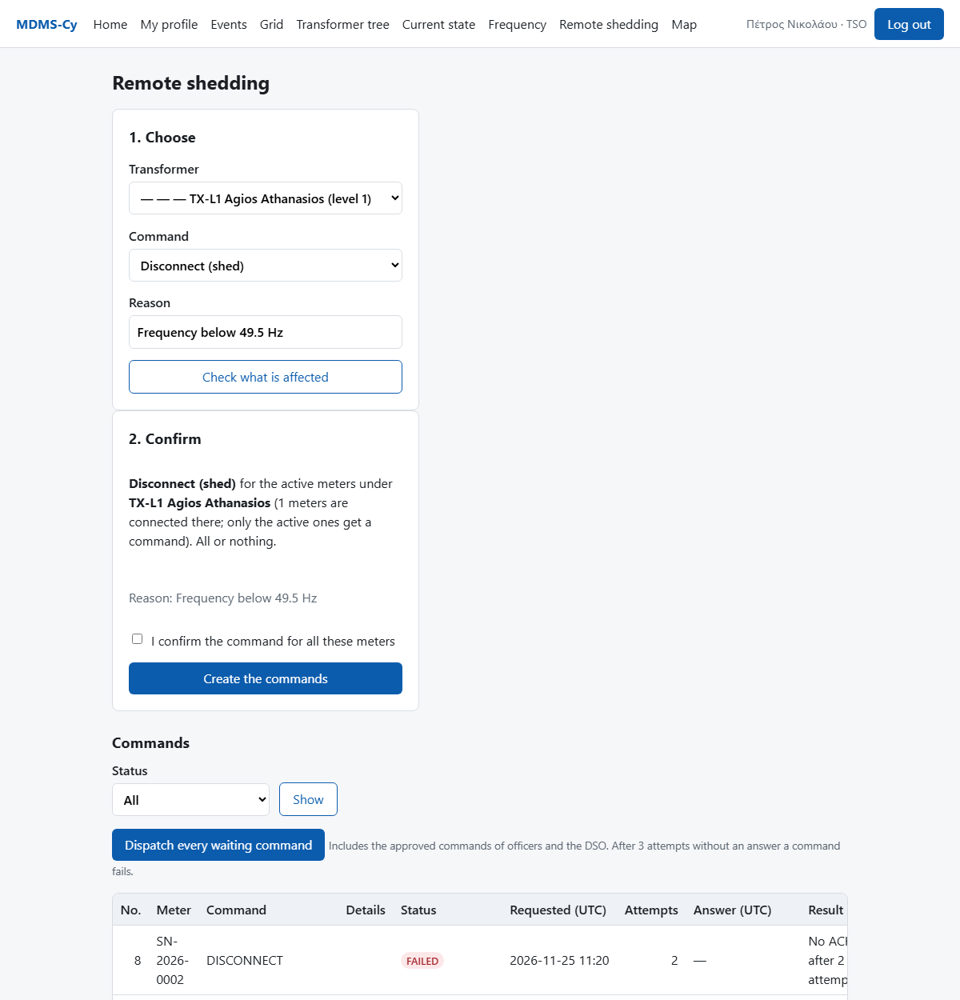{width=4.6in}

---

# Part C — Map

**Purpose.** The grid on a map (bonus, p. 2). **Who.** TSO, DSO, officers and the administrator. **Procedures.** `sp_GetTransformerTree`, `sp_ListMeters`, `sp_FindGeofenceForPoint`.

- **Rectangles and circles** are the transformers, coloured by load: green up to 70 %, orange up to 100 %, red above, grey without data. Click one for its state.
- **Blue points** are the active meters (grey = not active). Click one for its serial number, status and transformer.
- **Click anywhere else** to find the geofences of that place, level by level.
- **Level** shows one level; **Show meters** hides or shows the points. At most 5,000 meters are drawn; the page says when there are more.

The map library is served by the site. The background comes from OpenStreetMap, so it needs the internet; without it the transformers and meters still appear.

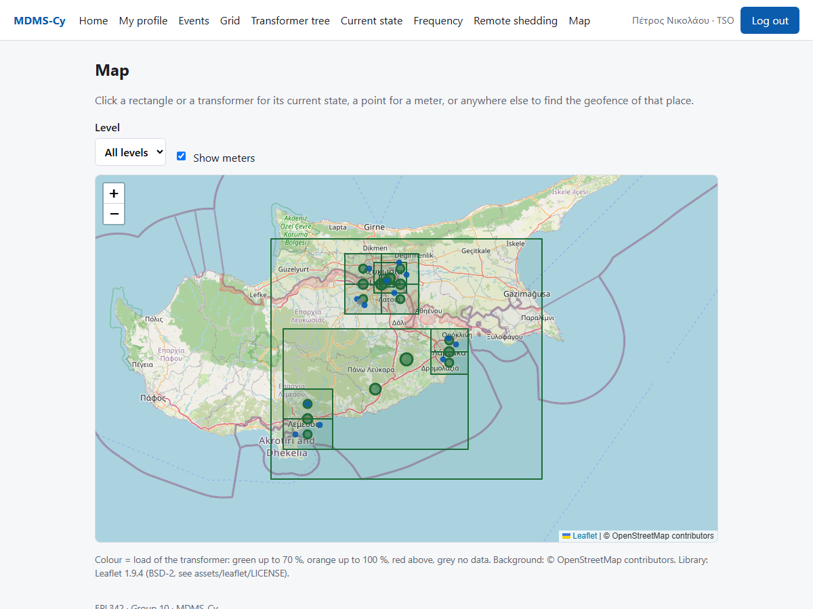{width=4.6in}
